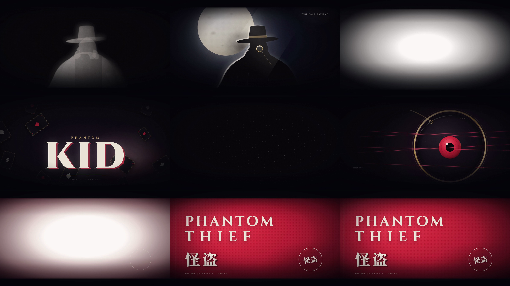
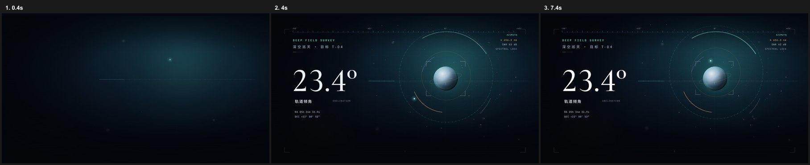
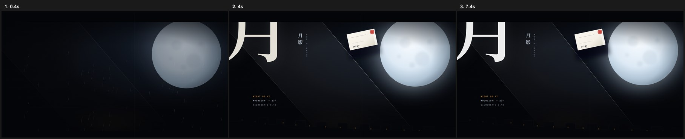
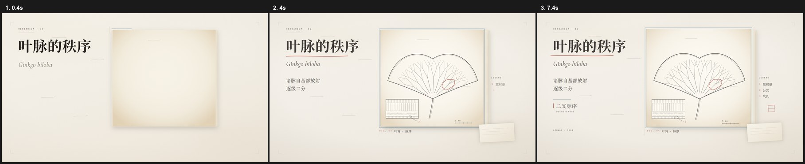
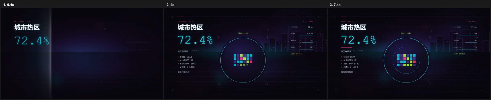

<div align="center">

# Video Factory

**把一个视频主题，交给 AI，从创意简报一路推进到可交付成片。**

<a href="https://github.com/sinxy-sai/video-factory"></a>
<a href="https://nodejs.org/"></a>
<a href="https://www.typescriptlang.org/"></a>
<a href="https://www.remotion.dev/"></a>
<a href="https://hyperframes.heygen.com/"></a>
<a href="LICENSE"></a>

[快速开始](#quick-start) · [模板画廊](#visual-system-gallery) · [工作流](#production-pipeline) · [文档](#documentation-map) · [更新记录](CHANGELOG.md)

</div>

<p align="center">
  
</p>

## Overview

Video Factory 是一个面向 AI 编码工具的视频工作流引擎。打开仓库，对 AI 说出主题、受众、时长和平台，它会把需求拆成内容计划、视觉方向、逐镜设计、确定性动画、字幕和最终合成。

项目把浏览器镜头、代码动画、总合成和编码连接成一条可验证的生产链：HyperFrames 负责逐帧 HTML 镜头，GSAP 负责镜头内时间轴，Remotion 负责 episode 时间轴与字幕，FFmpeg 负责图层合成和封装，Manim 可选用于公式、几何和矩阵镜头。

> **One topic in, one reproducible video out.**

## What it produces

| 模式 | 时长 | 字幕 | 适用场景 |
| --- | ---: | --- | --- |
| **explainer** | 40–90 s | 必须 | 知识解释、机制拆解、因果关系、对比分析 |
| **cinematic** | 15–30 s | 可选 | 视觉 PV、片头、预告、品牌氛围片 |

标准输出为：

```text
renders/<episode-id>/final.mp4
renders/<episode-id>/final.manifest.json
renders/<episode-id>/output-verification.json
```

## Why this workflow

- **AI-native**：根目录的 `AGENTS.md` / `CLAUDE.md` 把制作流程写成 AI 可以执行的生产合同。
- **Art-directed**：四套命名美术系统、构图原型、字号阶、色板和材质规则，帮助镜头保持统一风格。
- **Hero frame first**：先做静态画面，再绑定时间轴和动画，避免“能动但不好看”。
- **Deterministic**：所有状态由帧时间驱动，禁止 `Date.now()`、未播种随机和 hover 依赖。
- **Quality gates**：规划审批、ShotBrief、HyperFrames strict check、字幕覆盖、素材准备和 FFprobe 输出验证逐层把关。
- **Renderer routing**：浏览器、Manim 和分层合成按镜头需求路由，Remotion 只负责总合成。

## Visual system gallery

四套美术系统都提供可复制的 HyperFrames 模板。每套模板都有自己的构图、材质、字体和运动语言。

<table>
  <tr>
    <td width="50%"><strong>A · 深空天文台</strong><br>冷青辉光、轨道、科研仪器<br><a href="docs/assets/template-deep-space.jpg"></a><br><a href="templates/shot-starter/DESIGN.md">shot-starter · 设计说明</a></td>
    <td width="50%"><strong>B · 月夜怪盗</strong><br>月光、黑色电影、斜切、预告函<br><a href="docs/assets/template-noir.jpg"></a><br><a href="templates/shot-starter-noir/DESIGN.md">shot-starter-noir · 设计说明</a></td>
  </tr>
  <tr>
    <td><strong>C · 纸本编辑</strong><br>博物馆图版、线刻、纸张、朱批<br><a href="docs/assets/template-editorial.jpg"></a><br><a href="templates/shot-starter-editorial/DESIGN.md">shot-starter-editorial · 设计说明</a></td>
    <td><strong>D · 霓虹东京</strong><br>透视走廊、HUD、热区矩阵<br><a href="docs/assets/template-neon.jpg"></a><br><a href="templates/shot-starter-neon/DESIGN.md">shot-starter-neon · 设计说明</a></td>
  </tr>
</table>

以上均为实际模板渲染截图，依次采样 0.4、4、7.4 秒；点击图片查看大图。模板中的数值用于版式与动效演示，不代表真实测量。

复制一个模板后，替换短标签、主体几何和节拍即可：

```powershell
Copy-Item templates/shot-starter-editorial -Destination content/episodes/<id>/html/<shot-id> -Recurse
npx hyperframes check content/episodes/<id>/html/<shot-id> --strict
```

## Sample work

### Kid Phantom · 20-second cinematic PV

原创月夜黑色电影视觉 PV，使用系统 B，四镜、无字幕、1920×1080、30 fps。接触表展示了从月夜建立到标题落定的节奏变化。


## Quick start

环境要求：Node.js 20+。项目优先使用本地 `.venv`、`tools/ffmpeg/bin` 和 HyperFrames 运行时，不要求系统 PATH 中预装 Python、Manim 或 FFmpeg。

```powershell
git clone https://github.com/sinxy-sai/video-factory.git
cd video-factory
npm install
npm run doctor
npm run check-agent-harness
```

`npm install` 安装 JavaScript 依赖。FFmpeg / FFprobe 需另行放入 `tools/ffmpeg/bin/`，不会随 Git 克隆或 npm 安装自动提供。当前 `doctor` 还会检查 `.venv` 中的 Python / Manim；可用下面的 `setup:python` 配置它们。首次 Remotion 渲染可能下载 Chrome Headless Shell，字体加载也需要网络。

创建一个新 episode：

```powershell
npm run create-episode -- my-video
```

然后在支持 `AGENTS.md` 的 AI 编码工具中打开仓库，直接说：

```text
做一支 60 秒、横屏、带中文字幕的 Transformer 注意力机制科普视频，面向 B 站观众。
```

如果要使用 Manim：

```powershell
npm run setup:python
```

## Production pipeline

```text
brief
  ↓
content-plan.md + shot-design.md
  ↓
approve-episode
  ↓
script / storyboard / visual-style
  ↓
ShotBrief + manifest
  ↓
hero frames
  ↓
HyperFrames / Manim shots
  ↓
validate-episode-shots
  ↓
prepare-episode-assets
  ↓
validate-episode
  ↓
Remotion + FFmpeg render
  ↓
contact sheet + still-frame QC
  ↓
verify-episode-output
```

### Core commands

| 阶段 | 命令 |
| --- | --- |
| 新建 | `npm run create-episode -- <id>` |
| 批准规划 | `npm run approve-episode -- <id>` |
| 查看进度 | `npm run episode-status -- <id>` |
| 校验规划 | `npm run validate-episode-planning -- <id>` |
| 校验镜头 | `npm run validate-episode-shots -- <id> [--shot <shot-id>]` |
| 预览镜头 | `npm run preview-episode-shots -- <id> [--shot <shot-id>]` |
| 渲染镜头 | `npm run render-episode-shots -- <id> [--shot <shot-id>]` |
| 准备素材 | `npm run prepare-episode-assets -- <id>` |
| 校验整集 | `npm run validate-episode -- <id>` |
| 渲染整集 | `npm run render-episode -- <id>` |
| 生成接触表 | `npm run generate-contact-sheet -- <id>` |
| 验证输出 | `npm run verify-episode-output -- <id>` |
| 全量测试 | `npm test` |

## Project structure

```text
.
├── content/episodes/<id>/       # episode 计划、剧本、ShotBrief、镜头源码和素材
│   ├── manifest.ts               # scene、时长、beats、captions
│   ├── episode.ts                # episode 本地视觉枚举
│   ├── shot-briefs/              # 逐镜 renderer / 连续性 / 输出契约
│   ├── html/<shot-id>/           # HyperFrames 浏览器镜头
│   └── manim/<shot-id>/          # 可选 Manim 镜头
├── templates/                    # 四套可复制的美术系统镜头模板
├── src/                          # Remotion 总合成、字幕和电影感叠加层
├── production/                   # renderer 路由、ShotBrief 契约和合成
├── scripts/                      # create / validate / preview / render / verify
├── docs/                         # 工作流、艺术方向、质量与 README 展示资源
├── skills/                       # AI 制片 playbook
├── renders/<id>/                 # final.mp4、manifest、接触表和验证结果
└── static/episodes/<id>/         # 由脚本生成的 Remotion 运行时资源
```

## Documentation map

- [AI production playbook](skills/science-video-workflow/SKILL.md)
- [Workflow lifecycle](docs/WORKFLOW.md)
- [Scene and ShotBrief contract](docs/SCENE_GUIDE.md)
- [Component boundaries](docs/COMPONENT_GUIDE.md)
- [Art direction systems](docs/ART_DIRECTION.md)
- [Quality checklist](docs/QUALITY.md)
- [Contributing](CONTRIBUTING.md)

## Known limitations

- 当前没有自动配音、配乐或音效生成；旁白以脚本和字幕时间轴存在。
- 字体优先从 Google Fonts 缓存，离线环境可能回退到本机字体，字宽会有差异。
- 实际视频渲染主要在 Windows 环境验证；跨平台脚本和 CI 校验已覆盖核心工程契约。
- Manim 是可选 renderer；Blender 目前只有契约，没有执行器。
- `check` 和 `validate` 是底线门禁，不能代替首帧、中段、尾帧和接触表的目视审片。

## Development

```powershell
npm test
npm run check-agent-harness
npm run doctor
```

修改 `skills/science-video-workflow/SKILL.md` 后运行 `npm run sync-agent-harness-skill`，再运行 `npm run check-agent-harness` 确认三个 harness 副本一致。

## License

This project is licensed under the [MIT License](LICENSE).

## References

- Repository: [sinxy-sai/video-factory](https://github.com/sinxy-sai/video-factory)
- HyperFrames: [hyperframes.heygen.com](https://hyperframes.heygen.com/)
- Remotion: [remotion.dev](https://www.remotion.dev/)
- GSAP: [gsap.com](https://gsap.com/)
- Manim: [manim.community](https://www.manim.community/)
- FFmpeg: [ffmpeg.org](https://ffmpeg.org/)
